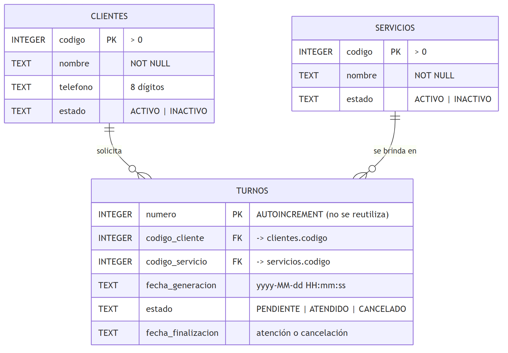
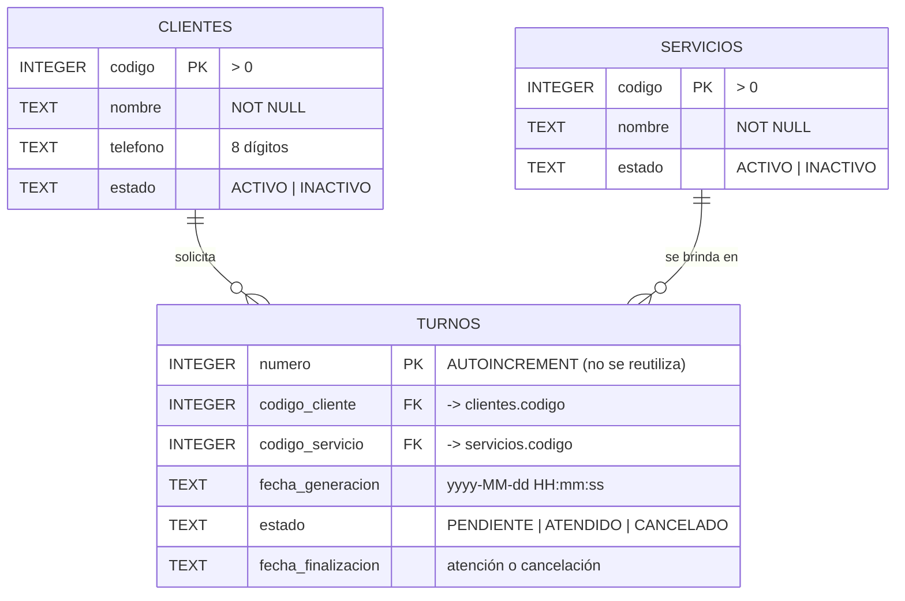

# Diagrama entidad-relación

Fuente Mermaid del diagrama:

Base de datos SQLite: `data/turnos.db` (script: `sql/crear_y_cargar.sql`).

## Restricciones

- `turnos.codigo_cliente` → `clientes.codigo` y `turnos.codigo_servicio` → `servicios.codigo` (claves foráneas; se habilitan en cada conexión con `PRAGMA foreign_keys = ON`).
- Índice único parcial `ux_turnos_pendiente_por_cliente`: un cliente solo puede tener un turno `PENDIENTE` a la vez.
- `CHECK` sobre `fecha_finalizacion`: es nula solo mientras el turno está pendiente.
- `numero` usa `AUTOINCREMENT`, por lo que SQLite nunca reutiliza números de turno, incluso si se borraran filas.
