# Diagrama UML de clases

> GitHub y VS Code (con la extensión *Markdown Preview Mermaid Support*) muestran este diagrama renderizado.

```mermaid
classDiagram
    direction TB

    %% ===================== MODELO =====================
    namespace modelo {
        class Cliente {
            -int codigo
            -String nombre
            -String telefono
            -boolean activo
            +getCodigo() int
            +getNombre() String
            +setNombre(String)
            +getTelefono() String
            +setTelefono(String)
            +isActivo() boolean
            +setActivo(boolean)
        }
        class Servicio {
            -int codigo
            -String nombre
            -boolean activo
            +getCodigo() int
            +getNombre() String
            +setNombre(String)
            +isActivo() boolean
            +setActivo(boolean)
        }
        class Turno {
            -int numero
            -int codigoCliente
            -int codigoServicio
            -LocalDateTime fechaGeneracion
            -EstadoTurno estado
            -LocalDateTime fechaFinalizacion
            +estaPendiente() boolean
            +marcarAtendido(LocalDateTime)
            +marcarCancelado(LocalDateTime)
        }
        class EstadoTurno {
            <<enumeration>>
            PENDIENTE
            ATENDIDO
            CANCELADO
        }
        class ResumenServicio {
            -int codigoServicio
            -String nombreServicio
            -int pendientes
            -int atendidos
            -int cancelados
            +contar(EstadoTurno)
            +sumar(ResumenServicio)
            +getTotal() int
        }
    }

    %% ===================== ESTRUCTURAS =====================
    namespace estructuras {
        class Nodo~T~ {
            -T dato
            -Nodo~T~ siguiente
        }
        class ColaTurnos {
            -Nodo~Turno~ frente
            -Nodo~Turno~ fin
            -int tamanio
            +encolar(Turno)
            +desencolar() Turno
            +verPrimero() Turno
            +buscar(int) Turno
            +cancelar(int) Turno
            +contieneCliente(int) boolean
            +recorrer(Consumer~Turno~)
            +aLista() List~Turno~
            +estaVacia() boolean
        }
        class NodoArbol {
            -Cliente cliente
            -NodoArbol izquierdo
            -NodoArbol derecho
        }
        class ArbolClientes {
            -NodoArbol raiz
            -int cantidad
            +insertar(Cliente) boolean
            +buscar(int) Cliente
            +recorrerInorden(Consumer~Cliente~)
            +inorden() List~Cliente~
            -insertarRecursivo(NodoArbol, Cliente) NodoArbol
            -buscarRecursivo(NodoArbol, int) Cliente
            -inordenRecursivo(NodoArbol, Consumer~Cliente~)
        }
    }

    %% ===================== ACCESO A DATOS =====================
    namespace datos {
        class ConexionSQLite {
            <<utility>>
            +obtenerConexion() Connection
        }
        class InicializadorBD {
            <<utility>>
            +inicializarSiEsNecesario() boolean
        }
        class ClienteDAO {
            <<interface>>
            +insertar(Cliente)
            +actualizarDatos(int, String, String)
            +actualizarEstado(int, boolean)
            +listarTodos() List~Cliente~
        }
        class ServicioDAO {
            <<interface>>
            +insertar(Servicio)
            +actualizarNombre(int, String)
            +actualizarEstado(int, boolean)
            +buscarPorCodigo(int) Servicio
            +listarTodos() List~Servicio~
        }
        class TurnoDAO {
            <<interface>>
            +insertar(int, int, LocalDateTime) Turno
            +finalizar(int, EstadoTurno, LocalDateTime) boolean
            +buscarPorNumero(int) Turno
            +listarPorEstado(EstadoTurno) List~Turno~
            +listarPorCliente(int) List~Turno~
            +listarTodos() List~Turno~
            +contarPendientesPorCliente(int) int
            +contarPendientesPorServicio(int) int
        }
        class ClienteDAOSQLite
        class ServicioDAOSQLite
        class TurnoDAOSQLite
    }

    %% ===================== NEGOCIO =====================
    namespace negocio {
        class ClienteService {
            +cargarClientes() int
            +registrar(int, String, String) Cliente
            +buscar(int) Cliente
            +listar() List~Cliente~
            +actualizar(int, String, String) Cliente
            +cambiarEstado(int, boolean) Cliente
        }
        class ServicioService {
            +registrar(int, String) Servicio
            +listar() List~Servicio~
            +buscar(int) Servicio
            +actualizar(int, String) Servicio
            +cambiarEstado(int, boolean) Servicio
        }
        class TurnoService {
            +cargarPendientes() int
            +generar(int, int) Turno
            +atenderSiguiente() Turno
            +cancelar(int) Turno
            +listarPendientes() List~Turno~
            +listarAtendidos() List~Turno~
            +listarCancelados() List~Turno~
            +historialCliente(int) List~Turno~
        }
        class ReporteService {
            +resumenPorServicio() List~ResumenServicio~
            +calcularTotal(List~ResumenServicio~) ResumenServicio
        }
    }

    %% ===================== VISTA =====================
    namespace vista {
        class Consola {
            +leerTexto(String) String
            +leerEntero(String) int
        }
        class MenuPrincipal {
            +iniciar()
        }
        class MenuClientes {
            +mostrar()
        }
        class MenuServicios {
            +mostrar()
        }
        class PresentadorTurnos {
            +imprimirTabla(List~Turno~, String)
            +describir(Turno) String
        }
    }

    class Proyectofinal {
        +main(String[])$
    }

    %% Relaciones
    Turno --> EstadoTurno
    ColaTurnos o--> Nodo
    Nodo --> Turno : dato
    ArbolClientes o--> NodoArbol
    NodoArbol --> Cliente

    ClienteDAO <|.. ClienteDAOSQLite
    ServicioDAO <|.. ServicioDAOSQLite
    TurnoDAO <|.. TurnoDAOSQLite
    ClienteDAOSQLite ..> ConexionSQLite
    ServicioDAOSQLite ..> ConexionSQLite
    TurnoDAOSQLite ..> ConexionSQLite

    ClienteService --> ClienteDAO
    ClienteService --> TurnoDAO
    ClienteService --> ArbolClientes
    ServicioService --> ServicioDAO
    ServicioService --> TurnoDAO
    TurnoService --> TurnoDAO
    TurnoService --> ColaTurnos
    TurnoService --> ClienteService
    TurnoService --> ServicioService
    ReporteService --> ServicioDAO
    ReporteService --> TurnoDAO
    ReporteService ..> ResumenServicio

    MenuPrincipal --> MenuClientes
    MenuPrincipal --> MenuServicios
    MenuPrincipal --> PresentadorTurnos
    MenuPrincipal --> TurnoService
    MenuPrincipal --> ReporteService
    MenuClientes --> ClienteService
    MenuServicios --> ServicioService
    MenuPrincipal --> Consola

    Proyectofinal ..> InicializadorBD
    Proyectofinal ..> MenuPrincipal
```

## Capas (MVC + responsabilidad única)

| Paquete | Responsabilidad |
|---|---|
| `modelo` | Clases de dominio `Cliente`, `Servicio`, `Turno`, `EstadoTurno`, `ResumenServicio`. |
| `estructuras` | `Nodo<T>` y `ColaTurnos` (cola FIFO enlazada propia); `NodoArbol` y `ArbolClientes` (BST propio, recursivo). |
| `datos` | `ConexionSQLite`, `InicializadorBD`, interfaces DAO. `datos.sqlite`: implementaciones JDBC. |
| `negocio` | Servicios con validaciones y coordinación BD ↔ cola/BST. |
| `vista` | Menús de consola, lectura validada de datos y presentación de resultados. |
| `Proyectofinal` | Punto de entrada: arma las dependencias e inicia el menú. |
