# Informe — Secuencia de comprobación

**Proyecto:** Sistema de Turnos — Oficina de Servicios Integrales
**Curso:** Programación II — Proyecto final
**Grupo:** 7
**Integrante:** Brenda Maribel Oviedo Catalan — Carné 6691-25-3920
**Repositorio:** <https://github.com/brendaOviedo/proyecto_final>

## 1. Condiciones de la prueba

- La prueba partió de una base de datos nueva, creada por la aplicación desde `sql/crear_y_cargar.sql`, con 5 clientes, 3 servicios y 0 turnos.
- Se ejecutó con Java 21 (`java -jar target/proyectofinal-1.0-SNAPSHOT-jar-with-dependencies.jar`).
- El paso 6 se realizó cerrando el programa con la opción `0. Salir` y volviendo a abrirlo. La cola se reconstruyó desde SQLite.
- Las capturas muestran la salida real de la consola de cada paso, incluidos los valores escritos por el usuario. Para que cada captura sea breve, se omite el menú principal repetido entre operaciones; el menú completo aparece en la captura de inicio.
- La transcripción completa está en [`evidencias/ejecucion1_pasos1-5.txt`](evidencias/ejecucion1_pasos1-5.txt) y [`evidencias/ejecucion2_pasos6-10.txt`](evidencias/ejecucion2_pasos6-10.txt).

## 2. Resumen de resultados

| Paso | Operación | Resultado esperado | Resultado obtenido | Cumple |
|---|---|---|---|---|
| 1 | Buscar al cliente 1003 mediante el BST | Mostrar a María García | `1003  María García  55501003  Activo` | Sí |
| 2 | Generar turnos 1001/1, 1002/2, 1003/1, 1004/3, 1005/2 | Crear turnos 1 a 5 | Turnos #1, #2, #3, #4 y #5 creados en ese orden | Sí |
| 3 | Generar otro turno para 1001 | Rechazarlo | `El cliente 1001 ya tiene un turno pendiente.` | Sí |
| 4 | Cancelar el turno 3 | Cola: 1, 2, 4, 5 | Pendientes: 1, 2, 4, 5 | Sí |
| 5 | Atender dos turnos | Primero 1, después 2 | Atendidos #1 y #2; quedan 4 y 5 | Sí |
| 6 | Cerrar y volver a abrir | Cola reconstruida con 4 y 5 | `Turnos pendientes en cola: 2`; pendientes 4 y 5 | Sí |
| 7 | Atender los restantes | Primero 4, después 5 | Atendidos #4 y #5 | Sí |
| 8 | Atender nuevamente | Informar que no hay pendientes | `No existen turnos pendientes.` | Sí |
| 9 | Historial del cliente 1003 | Turno 3 cancelado | Turno 3, servicio Información, `CANCELADO` | Sí |
| 10 | Resumen por servicio | Tabla esperada | Coincide con la tabla esperada | Sí |

### Resumen por servicio obtenido

| Servicio | Pendientes | Atendidos | Cancelados | Total |
|---|---:|---:|---:|---:|
| Información | 0 | 1 | 1 | 2 |
| Entrega de documentos | 0 | 2 | 0 | 2 |
| Actualización de datos | 0 | 1 | 0 | 1 |
| **Total** | **0** | **4** | **1** | **5** |

## 3. Capturas principales

### Inicio del programa

Se crea la base de datos con los datos iniciales, se cargan 5 clientes en el BST y la cola inicia vacía.

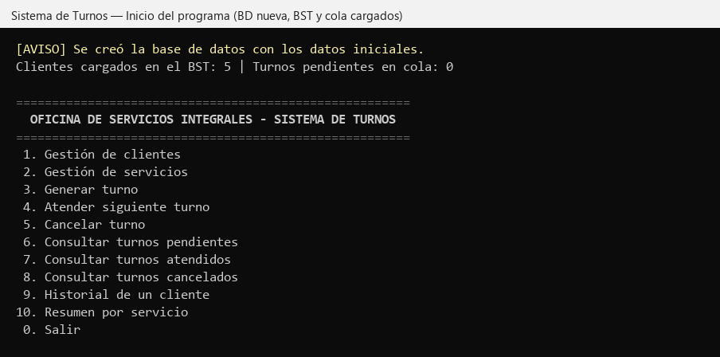

### Paso 1 — Buscar al cliente 1003 mediante el BST

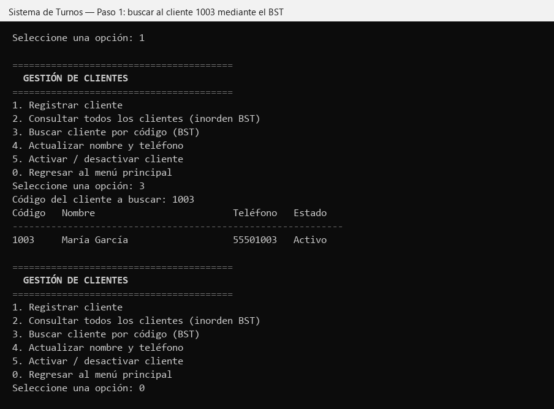

### Paso 2 — Generar los turnos 1 a 5

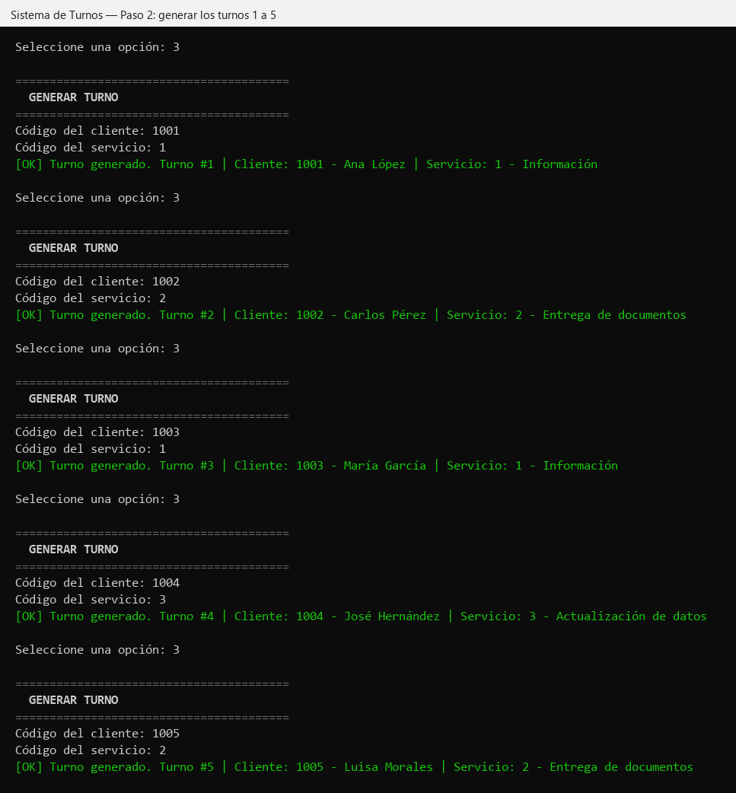

### Paso 3 — Rechazo de un segundo turno para el cliente 1001

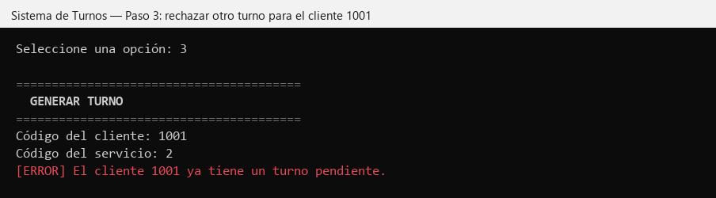

### Paso 4 — Cancelar el turno 3 (la cola conserva el orden 1, 2, 4, 5)

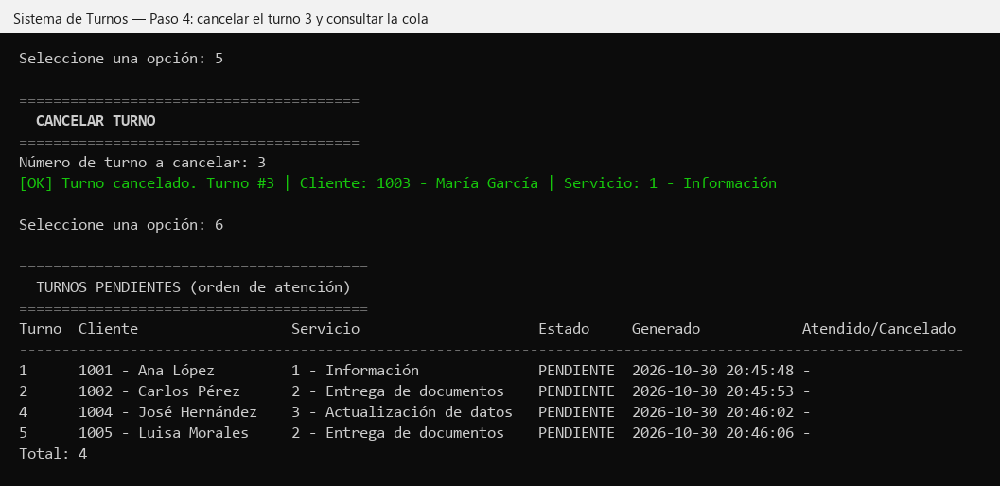

### Paso 5 — Atender dos turnos (FIFO: 1 y luego 2)

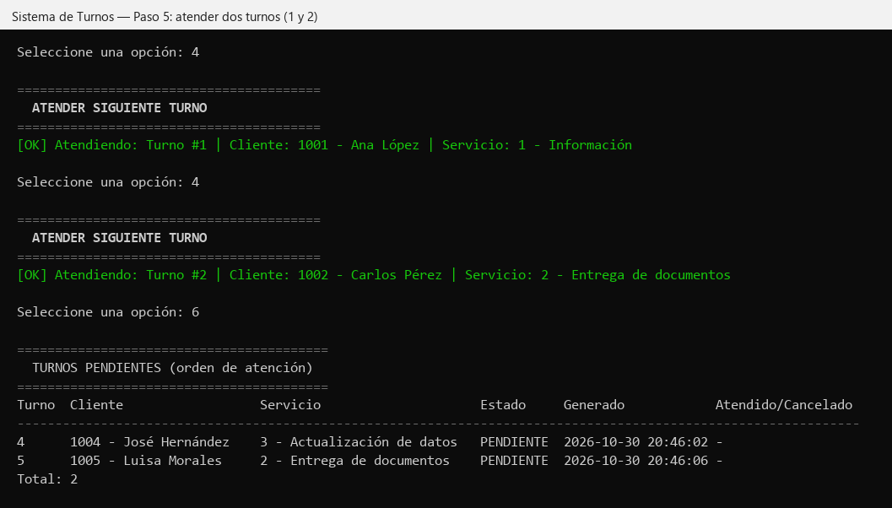

### Paso 6 — Cerrar y volver a abrir el programa

Al cerrar:

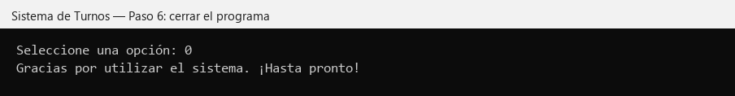

Al volver a abrir, la cola se reconstruye desde SQLite con los turnos 4 y 5:

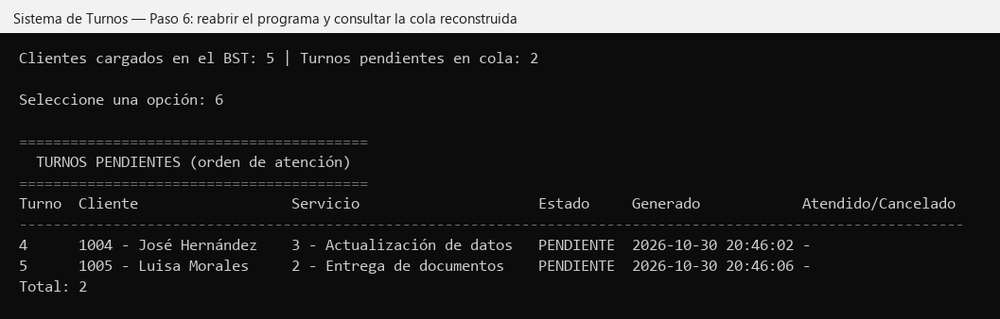

### Paso 7 — Atender los turnos restantes (4 y luego 5)

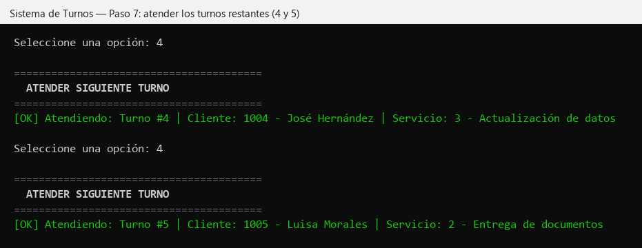

### Paso 8 — Intentar atender sin turnos pendientes

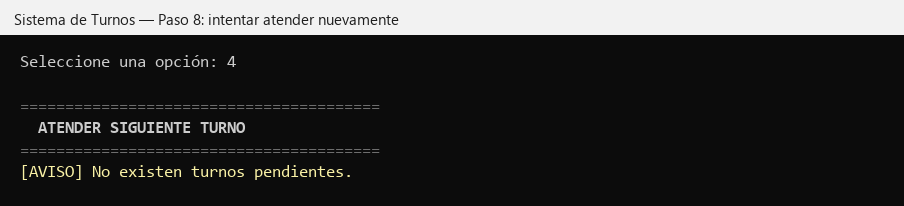

### Paso 9 — Historial del cliente 1003

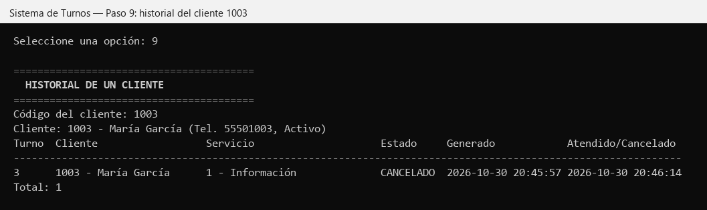

### Paso 10 — Resumen por servicio

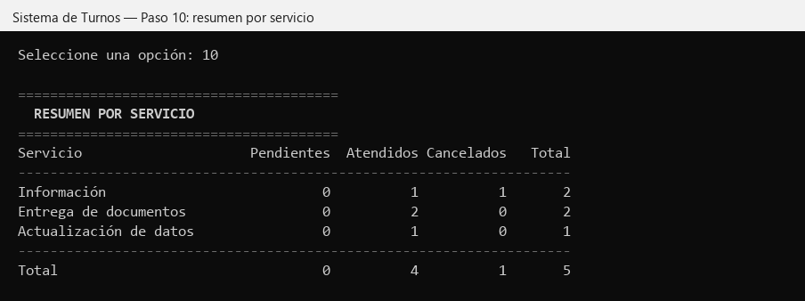

## 4. Validaciones adicionales comprobadas

| Caso | Mensaje del sistema |
|---|---|
| Opción inexistente (`99`) | `La opción 99 no existe.` |
| Texto en lugar de número (`abc`) | `"abc" no es un número entero válido.` |
| Entrada vacía | `El valor no puede estar vacío.` |
| Cliente no registrado (`9999`) | `No existe un cliente con el código 9999.` |
| Nombre vacío | `El campo nombre completo es obligatorio.` |
| Teléfono `123` | `El teléfono debe contener exactamente 8 dígitos.` |
| Código de cliente repetido | `Ya existe un cliente con el código 1001.` |
| Código negativo | `El código del cliente debe ser un número entero positivo.` |
| Desactivar cliente con turno pendiente | `No se puede desactivar al cliente 1006 porque tiene un turno pendiente.` |
| Desactivar servicio con turnos pendientes | `No se puede desactivar el servicio 1 porque tiene turnos pendientes.` |
| Turno para servicio inactivo | `El servicio 4 está inactivo.` |
| Turno para servicio inexistente | `No existe un servicio con el código 77.` |
| Turno para cliente inactivo | `El cliente 1006 está inactivo y no puede recibir turnos.` |
| Cancelar turno ya atendido | `El turno 1 no se puede cancelar porque está ATENDIDO.` |
| Cancelar turno inexistente | `No existe un turno con el número 999.` |

En todos los casos el programa muestra el mensaje y continúa en el menú.

## 5. Conclusión

La aplicación cumple los 10 pasos de la secuencia de comprobación.

- La cola enlazada propia respeta el orden FIFO y conserva el orden de los demás turnos al cancelar uno.
- El BST localiza a los clientes por código.
- SQLite conserva los estados entre ejecuciones, y al reiniciar se reconstruyen la cola y el árbol.

Después de las pruebas, la base de datos `data/turnos.db` se entrega con los datos iniciales y sin turnos.
